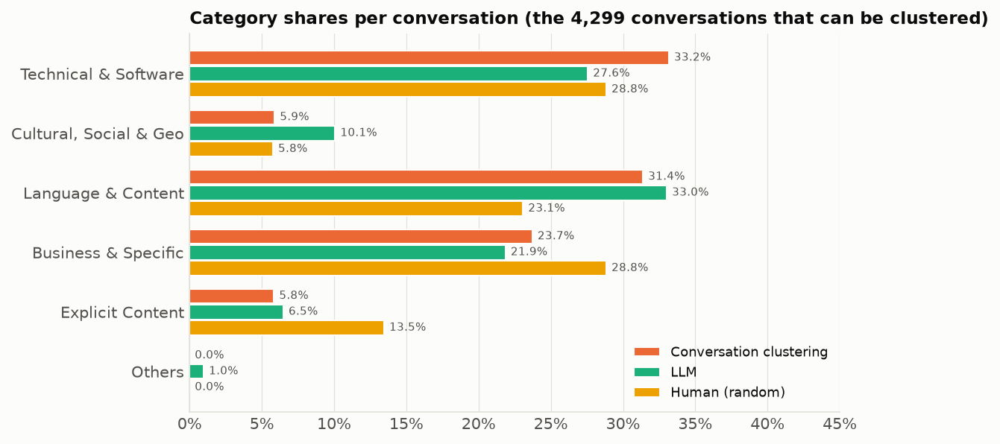

# LMSYS-Chat-1M Analysis

I analyzed LMSYS-Chat-1M, one million real conversations with 25 chatbots. The original paper ([Zheng et al., 2023](https://arxiv.org/html/2309.11998v4)) embedded user prompts, clustered them into 20 topics with k-means and grouped the topics into 5 categories. I followed that approach and added three questions: **does the unit matter** (prompts vs whole conversations), **how well do different categorization methods agree** (human, LLM, clustering), and **how do the models behave**, judged from their replies rather than the user's prompts.

## Data

A random sample of **5,000 English conversations** (seed 42) is the base. For my own labels I took **100**: **60 random**, to estimate shares, and **40 chosen via the dataset's OpenAI moderation flags**, because the traits I studied were rare. Following the paper, prompts under 32 or over 1,536 characters were excluded from clustering, which left **7,135 prompts** from **4,299 conversations**.

## Methods

I first built a small app to read conversations, and what I read shaped the labels: the paper's 5 categories plus **Others** (greetings and small talk); four attributes of the model's replies, namely **anthropomorphism, sycophancy, fear-inducing** and **harmful**; and **prevent unsafe content** (Yes / No / Not applicable), to compare the models on safety. I wrote these into one guideline file shared by me and the LLM, and revised it twice where categories overlapped. A conversation's category is the main theme of the user's messages. I labeled the 100 conversations in an annotation view that hides the moderation flags, and **gpt-6-luna** labeled all 5,000 with the same guidelines.

I then repeated the paper's clustering (all-mpnet-base-v2, k-means, k = 20) twice: **prompt clustering**, as in the paper, and **conversation clustering**, using the average of each conversation's prompt embeddings. An LLM named each cluster from its 100 most central items, as in the paper. I mapped every cluster to a category by hand before looking at any agreement, and gave clusters the paper's topic name wherever they were the same topic.

## Results

**Topics.** The paper's structure came back. Prompt clustering matched **12 of its 20 topics** and conversation clustering **11**, at similar sizes. Even its scripted-template clusters (chemical companies, plant growth) reappeared. The unit changes the shares. Templates are single-prompt conversations, so they weigh more per conversation (toxic requests: 3.1% of prompts, 5.9% of conversations). Long explicit role-plays weigh more per prompt: the same LLM labels give 6.5% Explicit per conversation and 8.4% per prompt, close to the paper's 9.6%.

**Categories.** Human and LLM agreed substantially (**κ = 0.70**), most likely because both followed the same written definitions. Clustering, which never saw them and groups prompts by wording, agreed only moderately (**κ = 0.45–0.47**). Language & Content was the largest category (33%) and Explicit the smallest of the paper's five (6%). Business exceeded the paper's share (21% vs 16%), most likely because my guidelines put general-knowledge questions there.

**Attributes and safety.** Each attribute appeared in under 5% of conversations, concentrated in a few models: anthropomorphism in llama-2-13b-chat (26%), and sycophancy and harmful replies in vicuna-33b (12% and 23%). Models prevented unsafe content only **54%** of the time, from llama-2-13b-chat (24 of 24) down to vicuna-33b (18%). Sexual requests were refused less often than other unsafe ones (38% vs 65%). OpenAI's moderation flags missed **57%** of the conversations labeled unsafe.

## Lessons

- **Reading conversations first paid off.** Browsing them in the app showed me the content, the traits and how the data is structured. That is where the *Others* category came from, and why *harmful* content and *unsafe-content prevention* became part of the study.
- **Testing the definitions improved them.** At first I took a conversation's category from its first substantive message. Testing on real conversations showed that topics drift across turns, so I moved to the main theme of the whole conversation.
- **The attribute sample was too small.** Traits appeared in under 5% of conversations, so 100 labeled conversations (40 of them flagged) gave few positive cases. A larger labeled sample, or a larger set selected by moderation flags, would make the attribute comparison more reliable.

## Links

- Repository: [github.com/tanmoyAtb/lmsys-1m-chat-analysis](https://github.com/tanmoyAtb/lmsys-1m-chat-analysis) (full report: [REPORT.md](REPORT.md))
- AI assistant log: [ai_assistant_log.txt](ai_assistant_log.txt)

## Selected charts

**The paper's 20 topics in my prompt and conversation clustering.** Matching topics share the paper's names; "–" means no matching cluster.

**Categories from conversation clustering, the LLM and my labels** (the 4,299 conversations that can be clustered).

**Human vs LLM on the same 100 conversations.**

**Unsafe-content prevention by model** (models with at least 20 unsafe requests; bars show 95% confidence intervals).

