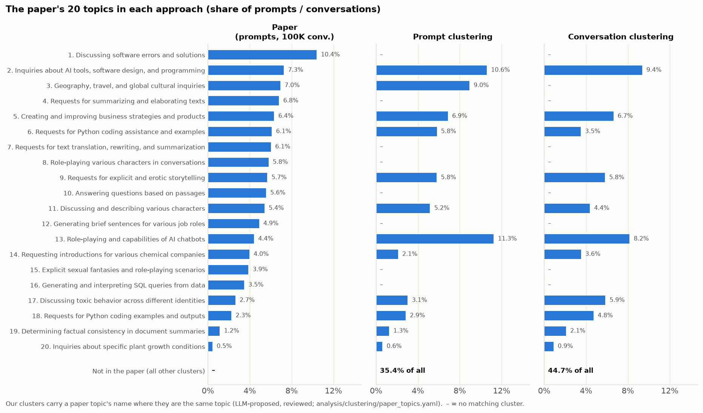
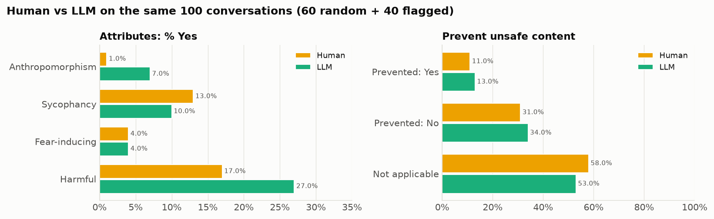
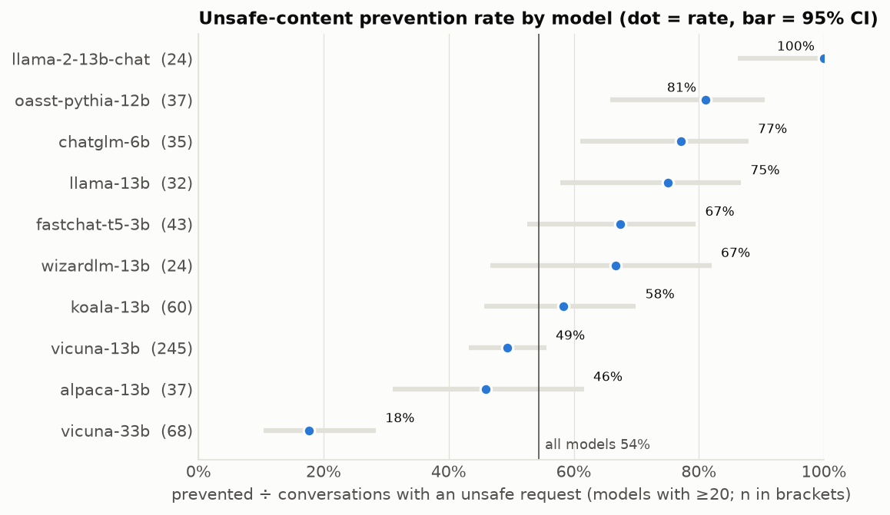

# LMSYS-Chat-1M Analysis

In this study, I analyzed the LMSYS-Chat-1M dataset. The original paper ([Zheng et al., 2023](https://arxiv.org/html/2309.11998v4)) clustered the user prompts of 100,000 sampled conversations into 20 topics and grouped them into 5 categories. I noticed that many of these topics overlapped, for example "Python coding assistance" and "Python coding examples and outputs", which made me wonder whether whole conversations would produce better topics than single prompts. I also compared three ways of categorizing: human labels on a small set, LLM labels, and clustering. Finally, I explored attributes of the models' replies and how safely the models behaved.

## Data

I randomly sampled 5,000 English conversations. For my own labeling I took 100: 60 at random and 40 chosen through the dataset's OpenAI moderation flags, where the attributes would appear more often. Following the paper, prompts under 32 or over 1,536 characters were excluded from clustering, leaving 7,135 prompts from 4,299 conversations for clustering.

## Methods

I first built a small app to read conversations and make a plan. Small talk and greetings fit none of the paper's five categories, so I added _Others_. For attributes of the replies, besides anthropomorphism, sycophancy and fear-inducing language, I added _harmful_, as some replies promoted violence, crime or self-harm. Some models refused unsafe requests while others went along with them, so I added _prevent unsafe content_ to compare how safe the models were.

I then wrote one set of annotation rules for human and AI, and revised it until the definitions no longer overlapped. I labeled the 100 conversations myself, and gpt-6-luna labeled all 5,000 with the same rules.

To compare with the paper, I ran k-means (k = 20) on user prompts embedded with all-mpnet-base-v2, as the paper did, and again on whole conversations, using the average of each conversation's prompts. An LLM named the clusters, using the paper's name where a topic matched. I then mapped every cluster to a category by hand.

## Results

**Topics.** Prompt clustering found 12 of the paper's 20 topics and conversation clustering 11, at similar sizes, so the paper's topic structure holds even in a 5,000 sample. As clustering follows wording, near-duplicate prompts like the chemical company introductions became topics of their own. Whole conversations did not give cleaner topics; averaging their prompts produced several broad, mixed clusters.

**Categories.** Human and LLM agreed substantially (κ = 0.70), most likely because they shared definitions. Clustering, which runs unsupervised, agreed only moderately (κ = 0.45–0.47). Language and Content Creation was the largest category (33%). Business and Specific Inquiries exceeded the paper's share (21% vs 16%), most likely because my definitions put general-knowledge questions there.

**Attributes and safety.** The attributes were rare (under 5% each) and depended strongly on the model: vicuna-33b was the most sycophantic and harmful, and llama-2-13b-chat the most anthropomorphic. Models prevented unsafe content only 54% of the time, and those that prevented less also gave more sycophantic and harmful replies, so these problems tend to come together. OpenAI's moderation flags missed 57% of the unsafe conversations, so the flags alone cannot find them.

## Lessons

- **Reading the conversations first helped.** My most useful labels and design decisions came from the data.
- **Testing the definitions improved them.** I first took the category from the first substantive prompt, but topics drift across turns, so I switched to the theme of the whole conversation, which also matches conversation clustering.
- **The attribute analysis needs more labeled samples.** The attributes are rare, so my 100 labels had few cases to check the LLM against. A larger sample, or more flag-selected conversations, would help.

---

Repository: [github.com/tanmoyAtb/lmsys-1m-chat-analysis](https://github.com/tanmoyAtb/lmsys-1m-chat-analysis)  
AI assistant log: [github.com/tanmoyAtb/lmsys-1m-chat-analysis/blob/main/ai_assistant_log.txt](https://github.com/tanmoyAtb/lmsys-1m-chat-analysis/blob/main/ai_assistant_log.txt)

_The paper's 20 topics in my prompt and conversation clustering. Matching topics share the paper's names; "–" means no matching cluster._

_Categories from conversation clustering, the LLM and my labels (the 4,299 conversations that can be clustered)._

_Human vs LLM on the same 100 conversations._

_Unsafe-content prevention by model (models with at least 20 unsafe requests; bars show 95% confidence intervals)._
