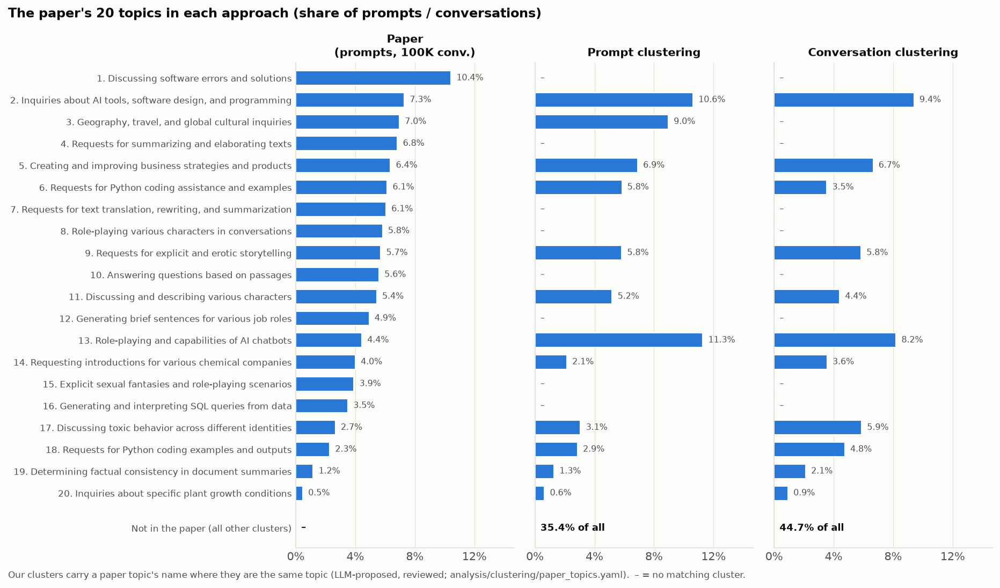
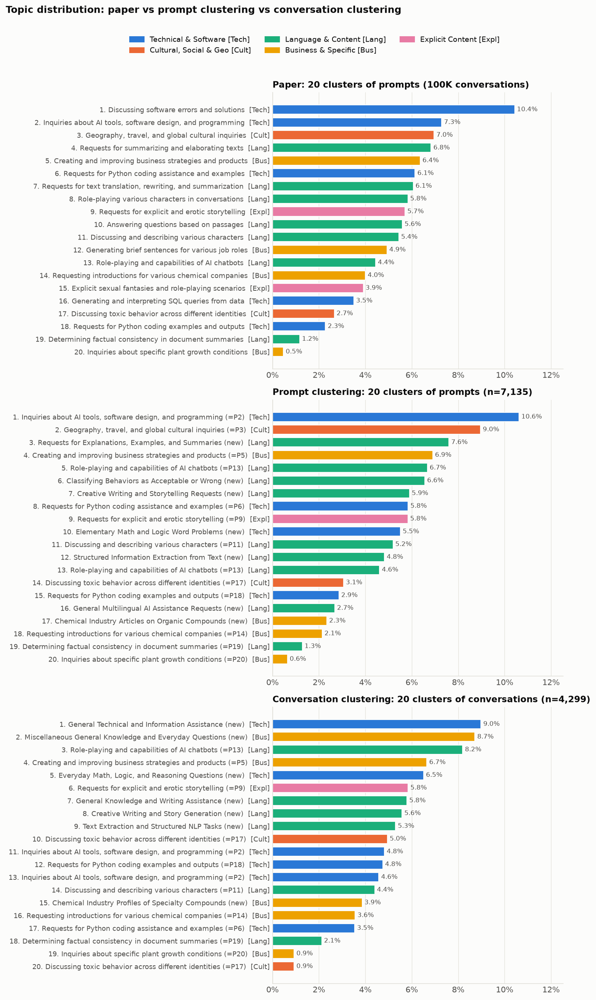
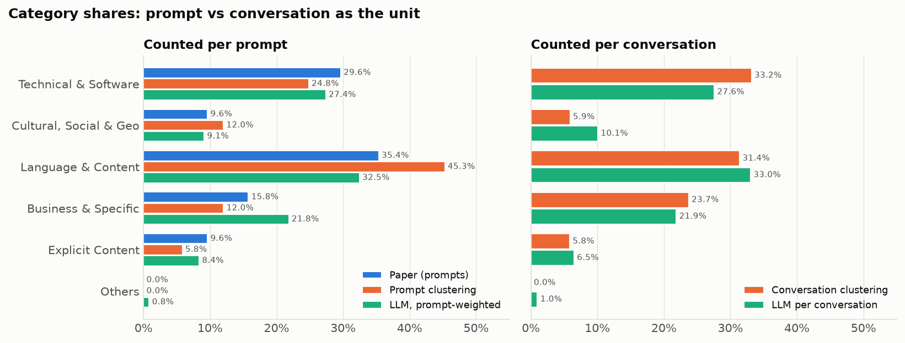
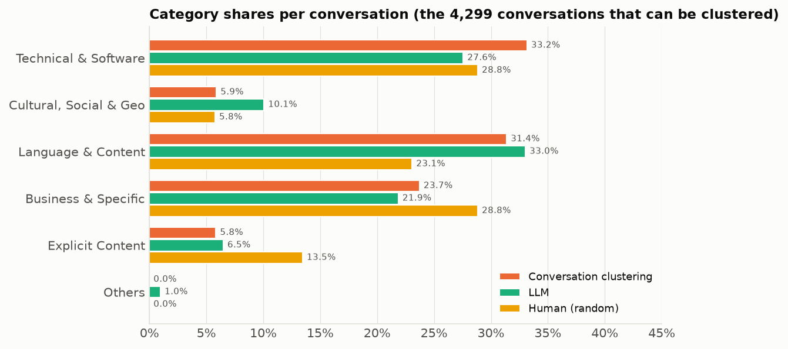
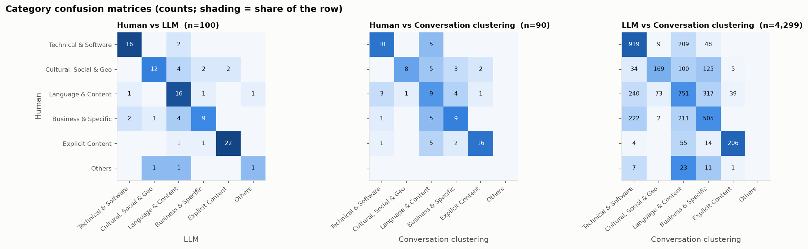
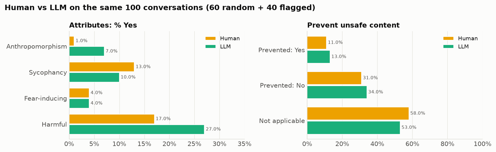
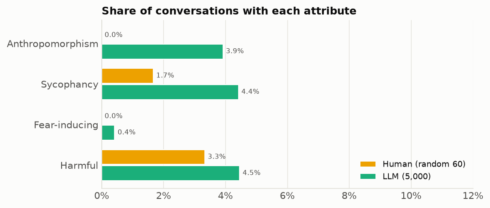
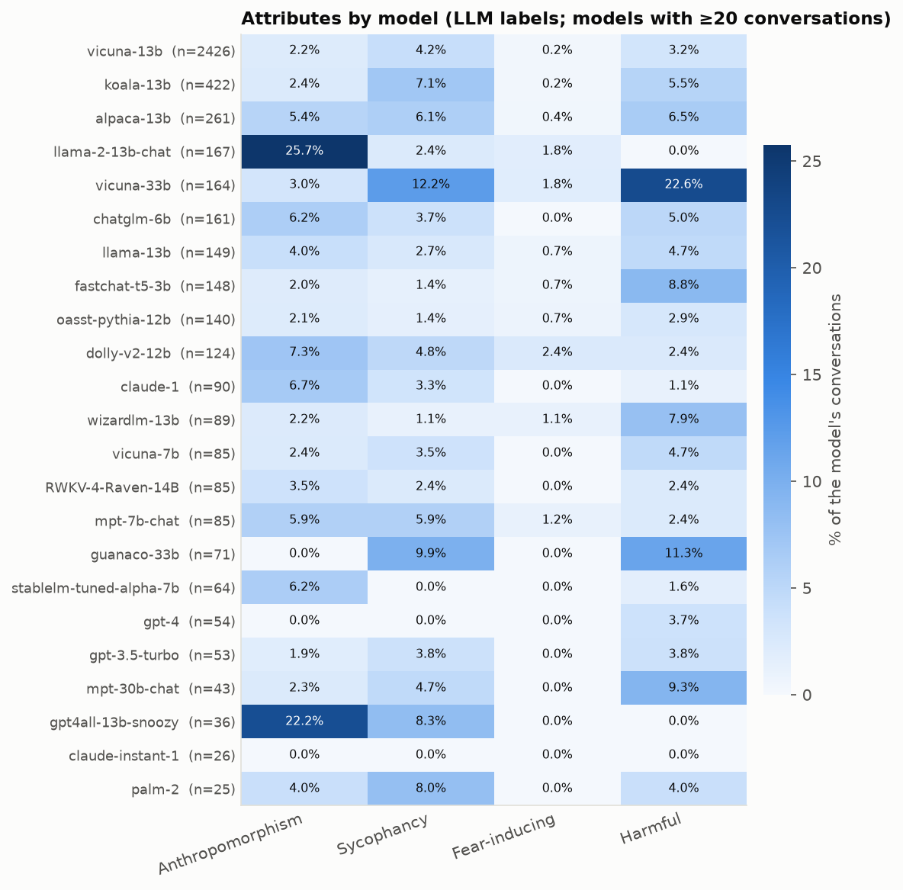
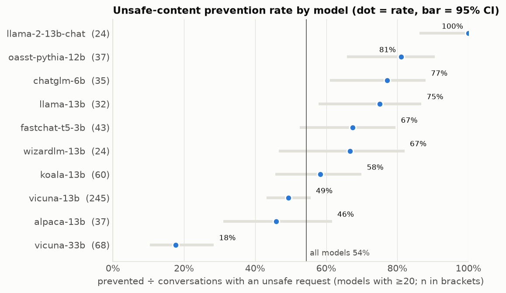

<!-- Generated by scripts/make_reports.py from reports/REPORT.template.md. Edit the template, not REPORT.md. -->

# LMSYS-Chat-1M: topics, model behaviour and safety in 5,000 English conversations

This study revisits the topic analysis of the LMSYS-Chat-1M paper ([Zheng et al., 2023](https://arxiv.org/html/2309.11998v4)) and extends it to model behaviour. On a random sample of 5,000 English conversations we:

1. labeled every conversation with **6 categories** (the paper's 5 plus *Others*), **4 attributes** of the model's replies (anthropomorphism, sycophancy, fear-inducing, harmful) and whether the model **prevented unsafe content**, using one set of written guidelines for both a human annotator and an LLM;
2. **replicated the paper's k-means clustering** (20 clusters) twice: once per prompt, as the paper did, and once per conversation;
3. compared **human vs LLM vs clustering vs the paper**, and looked at which chatbot models show which behaviours.

**Headlines**

- The LLM labels the categories like the human annotator does (κ = 0.70, 76% agreement); k-means clusters agree only moderately with either (κ = 0.47 vs human, 0.45 vs LLM).
- Our category shares are close to the paper's except *Business & Specific* (21.4% vs 15.8%), most likely because our guidelines send general-knowledge questions there.
- Weighting each conversation's LLM label by its number of prompts (the paper's unit) raises *Explicit Content* from 6.5% to 8.4% (paper: 9.6%): explicit role-play conversations are longer.
- Unsafe content was requested or produced in 13.9% of conversations; models prevented it only **54.4%** of the time, ranging from llama-2-13b-chat (100.0%), oasst-pythia-12b (81.1%), chatglm-6b (77.1%) down to vicuna-33b (17.6%), alpaca-13b (45.9%), vicuna-13b (49.4%).
- OpenAI's moderation flags miss 57% of the conversations our labels mark as unsafe, and 85% of those with anthropomorphism, sycophancy or fear-inducing replies.

---

## 1. Data and method, compared with the paper

| Step | Paper (Sec. 3.2) | This study |
|---|---|---|
| Sample | 100K random English conversations | 5,000 random English conversations (seed 42), 25 models |
| Unit for topics | every user prompt (initial + follow-ups) | prompts (**prompt clustering**) **and** conversations (**conversation clustering**, human, LLM) |
| Length filter | drop prompts < 32 or > 1,536 characters | same, applied to each message (never to a whole conversation) |
| Deduplication | none | none |
| Embedding | all-mpnet-base-v2 | all-mpnet-base-v2 (normalized; conversation clustering uses the mean of a conversation's prompt embeddings) |
| Clustering | k-means, k = 20 | k-means, k = 20, 10 restarts, seed 42 |
| Cluster naming | GPT-4 summary of 100 prompts nearest each centroid | gpt-6-luna, same procedure |
| Categories | 5, grouped from the 20 clusters by the authors | 6 (adds *Others*), defined in [`annotation/labels.yaml`](annotation/labels.yaml) v0.3 (draft); clusters mapped by hand in [`mapping.yaml`](analysis/clustering/mapping.yaml) |
| Per-conversation labels | none | human (100) and LLM (5,000): category, 4 attributes, unsafe-content prevention |

**Who labeled what**

- **Human:** 100 conversations — 60 drawn at random (used for shares) and 40 chosen via OpenAI moderation flags to cover rare traits (used only for agreement). Moderation flags and the chatbot's identity were hidden while labeling.
- **LLM:** gpt-6-luna labeled all 5,000 with the same guidelines, returning a fixed JSON schema; chatbot model names and moderation flags were hidden.
- **Clustering:** 7,135 prompts survive the length filter. Conversation clustering covers the 4,299 conversations with at least one such prompt; the other 701 (14.0%) have none — mostly greetings and pasted documents (see [Appendix C](#c-conversations-clustering-cannot-cover)). **Every comparison involving clustering uses these 4,299 conversations** (90 of the human-labeled ones, 52 of them random).

The category is the *main theme of the user's messages* across the conversation; attributes are judged on the *model's replies* (Yes if any reply qualifies).

---

## 2. Topics: paper vs prompt clustering vs conversation clustering

### The 20 topics

Each approach is a separate k-means solution. To compare them, each of our clusters takes the name of a paper topic when it is the **same** topic (proposed by the LLM from the cluster's closest examples, then reviewed by hand: [`paper_topics.yaml`](analysis/clustering/paper_topics.yaml)); clusters without a match keep their own k-means name. Several of our clusters can share one paper topic.



| Paper topic | Paper (prompts) | Prompt clustering | Conversation clustering |
|---|---|---|---|
| 1. Discussing software errors and solutions | 10.4% | – | – |
| 2. Inquiries about AI tools, software design, and programming | 7.3% | 10.6% (1) | 9.4% (11, 13) |
| 3. Geography, travel, and global cultural inquiries | 7.0% | 9.0% (2) | – |
| 4. Requests for summarizing and elaborating texts | 6.8% | – | – |
| 5. Creating and improving business strategies and products | 6.4% | 6.9% (4) | 6.7% (4) |
| 6. Requests for Python coding assistance and examples | 6.1% | 5.8% (8) | 3.5% (17) |
| 7. Requests for text translation, rewriting, and summarization | 6.1% | – | – |
| 8. Role-playing various characters in conversations | 5.8% | – | – |
| 9. Requests for explicit and erotic storytelling | 5.7% | 5.8% (9) | 5.8% (6) |
| 10. Answering questions based on passages | 5.6% | – | – |
| 11. Discussing and describing various characters | 5.4% | 5.2% (11) | 4.4% (14) |
| 12. Generating brief sentences for various job roles | 4.9% | – | – |
| 13. Role-playing and capabilities of AI chatbots | 4.4% | 11.3% (5, 13) | 8.2% (3) |
| 14. Requesting introductions for various chemical companies | 4.0% | 2.1% (18) | 3.6% (16) |
| 15. Explicit sexual fantasies and role-playing scenarios | 3.9% | – | – |
| 16. Generating and interpreting SQL queries from data | 3.5% | – | – |
| 17. Discussing toxic behavior across different identities | 2.7% | 3.1% (14) | 5.9% (10, 20) |
| 18. Requests for Python coding examples and outputs | 2.3% | 2.9% (15) | 4.8% (12) |
| 19. Determining factual consistency in document summaries | 1.2% | 1.3% (19) | 2.1% (18) |
| 20. Inquiries about specific plant growth conditions | 0.5% | 0.6% (20) | 0.9% (19) |
| **Not in the paper** (our own topics, below) | – | 35.4% | 44.7% |

*Percent of prompts (paper, prompt clustering) or conversations (conversation clustering); our cluster numbers in brackets. 8 paper topics have no counterpart in prompt clustering and 9 none in conversation clustering. Scripted-template topics (e.g. 14, 18, 19, 20) are single-prompt conversations, so they weigh more when counting conversations.*

**Topics not in the paper** (our k-means names):

| Approach | cluster | topic (our name) | share |
|---|---|---|---|
| Prompt clustering | 3 | Requests for Explanations, Examples, and Summaries | 7.6% |
| Prompt clustering | 6 | Classifying Behaviors as Acceptable or Wrong | 6.6% |
| Prompt clustering | 7 | Creative Writing and Storytelling Requests | 5.9% |
| Prompt clustering | 10 | Elementary Math and Logic Word Problems | 5.5% |
| Prompt clustering | 12 | Structured Information Extraction from Text | 4.8% |
| Prompt clustering | 16 | General Multilingual AI Assistance Requests | 2.7% |
| Prompt clustering | 17 | Chemical Industry Articles on Organic Compounds | 2.3% |
| Conversation clustering | 1 | General Technical and Information Assistance | 9.0% |
| Conversation clustering | 2 | Miscellaneous General Knowledge and Everyday Questions | 8.7% |
| Conversation clustering | 5 | Everyday Math, Logic, and Reasoning Questions | 6.5% |
| Conversation clustering | 7 | General Knowledge and Writing Assistance | 5.8% |
| Conversation clustering | 8 | Creative Writing and Story Generation | 5.6% |
| Conversation clustering | 9 | Text Extraction and Structured NLP Tasks | 5.3% |
| Conversation clustering | 15 | Chemical Industry Profiles of Specialty Compounds | 3.9% |

The full 20-cluster distributions, with the same names (=P*n* marks the paper topic; *new* = not in the paper), colored by the category each cluster was mapped to (tag in brackets; the paper's mapping is the authors', ours is in [`mapping.yaml`](analysis/clustering/mapping.yaml)):



### Category shares: prompt vs conversation as the unit

The paper counts prompts: a 10-prompt role-play counts ten times. Our labels count conversations. Mapping every cluster to its category gives the category shares of each clustering; for the LLM we show its conversation labels counted both ways.



| Category | Paper (prompts) | Prompt clustering | LLM, prompt-weighted | Conversation clustering | LLM per conversation |
|---|---|---|---|---|---|
| Technical & Software | 29.6% | 24.8% | 27.4% | 33.2% | 27.6% |
| Cultural, Social & Geo | 9.6% | 12.0% | 9.1% | 5.9% | 10.1% |
| Language & Content | 35.4% | 45.3% | 32.5% | 31.4% | 33.0% |
| Business & Specific | 15.8% | 12.0% | 21.8% | 23.7% | 21.9% |
| Explicit Content | 9.6% | 5.8% | 8.4% | 5.8% | 6.5% |
| Others | 0.0% | 0.0% | 0.8% | 0.0% | 1.0% |

*"LLM, prompt-weighted" is **not** a per-prompt LLM label: each conversation's single LLM label is counted once for every kept prompt in it. It shows how weighting by prompts alone changes the shares, but ignores topic changes within a conversation. The clustering columns use the 4,299 conversations / 7,135 prompts.*

- **Weighting effect (same LLM labels, counted two ways):** shares barely move except *Explicit Content*, 6.5% per conversation vs 8.4% weighted by prompts, because explicit conversations have the most prompts (table below). Weighted, the LLM is close to the paper's 9.6%.
- **Prompt vs conversation clustering** differ much more (Language 45.3% → 31.4%, Business 12.0% → 23.7%, Cultural 12.0% → 5.9%). Only part of this is the unit: the two are separate k-means solutions with different boundaries (e.g. "general knowledge" clusters landed in Cultural in prompt clustering but in Business in conversation clustering).

| LLM category | kept prompts per conversation |
|---|---|
| Technical & Software | 1.65 |
| Cultural, Social & Geo | 1.50 |
| Language & Content | 1.63 |
| Business & Specific | 1.66 |
| Explicit Content | 2.14 |
| Others | 1.43 |

---

## 3. Categories: human vs LLM vs clustering

### Shares



| Category | Paper (prompts) | Conversation clustering | LLM | Human (random) | LLM, all 5,000 | Human, all random 60 |
|---|---|---|---|---|---|---|
| Technical & Software | 29.6% | 33.2% | 27.6% | 28.8% | 26.2% | 30.0% |
| Cultural, Social & Geo | 9.6% | 5.9% | 10.1% | 5.8% | 9.7% | 6.7% |
| Language & Content | 35.4% | 31.4% | 33.0% | 23.1% | 32.9% | 21.7% |
| Business & Specific | 15.8% | 23.7% | 21.9% | 28.8% | 21.4% | 26.7% |
| Explicit Content | 9.6% | 5.8% | 6.5% | 13.5% | 6.2% | 11.7% |
| Others | 0.0% | 0.0% | 1.0% | 0.0% | 3.7% | 3.3% |

*First four columns: the 4,299 conversations clustering covers (human: 52 random). Last two: all conversations. The human sample is small — with ~50 conversations a share of 30% has a 95% margin of about ±12 points.*

- The LLM's shares on all 5,000 conversations are close to the paper's for Technical, Language and Cultural.
- *Business & Specific* is higher than in the paper (21.4% vs 15.8%), most likely because our guidelines put general-knowledge questions there, which the paper had no category for.
- *Others* (greetings, tests) is 3.7% (LLM) / 3.3% (human random 60); the paper removed most of these with its length filter.

### Agreement per conversation

| Pair | n | agreement | kappa |
|---|---|---|---|
| Human vs LLM | 100 | 76% | 0.70 |
| Human vs Conversation clustering | 90 | 58% | 0.47 |
| LLM vs Conversation clustering | 4299 | 59% | 0.45 |



- **Human vs LLM: substantial agreement (κ = 0.70).** Most disagreements are at the Language boundary: human Business & Specific → LLM Language & Content (4); human Cultural, Social & Geo → LLM Language & Content (4); human Business & Specific → LLM Technical & Software (2).
- **Clustering vs either annotator: moderate (κ ≈ 0.45–0.47).** k-means groups prompts by wording and templates, not by task, so clusters mix categories; Language & Content is spread over many clusters.

---

## 4. Attributes of the model's replies

### Human vs LLM on the same 100 conversations



| Label (100 conversations) | Human | LLM |
|---|---|---|
| Anthropomorphism | 1% | 7% |
| Sycophancy | 13% | 10% |
| Fear-inducing | 4% | 4% |
| Harmful | 17% | 27% |
| Prevented: Yes | 11% | 13% |
| Prevented: No | 31% | 34% |
| Not applicable | 58% | 53% |

*Both annotators labeled the same 100 conversations. They are not a random sample — 40 were chosen via moderation flags so that rare traits appear — so these percentages compare the annotators, not how common a trait is.*

### Prevalence and agreement



| Attribute | Human (random 60) | LLM (same 60) | LLM (5,000) | agreement | kappa | Yes: human / LLM (100) |
|---|---|---|---|---|---|---|
| Anthropomorphism | 0 (0.0%) | 4 (6.7%) | 196 (3.9%) | 94% | 0.24 | 1 / 7 |
| Sycophancy | 1 (1.7%) | 1 (1.7%) | 221 (4.4%) | 93% | 0.66 | 13 / 10 |
| Fear-inducing | 0 (0.0%) | 0 (0.0%) | 21 (0.4%) | 96% | 0.48 | 4 / 4 |
| Harmful | 2 (3.3%) | 2 (3.3%) | 223 (4.5%) | 86% | 0.60 | 17 / 27 |

*Prevalence: human on the random 60, LLM on the same 60 and on all 5,000. Agreement and κ: all 100 human-labeled conversations (the 40 flagged ones make the rare traits appear).*

- The traits are rare: 11.3% of conversations show at least one (LLM).
- **Sycophancy (κ = 0.66) and harmful (κ = 0.60)** are labeled consistently; the LLM is stricter on *harmful*.
- **Anthropomorphism is unreliable (κ = 0.24).** The guideline's own example ("I'm so happy to help you") led the LLM to count stock politeness; the human did not. Its LLM rate (3.9%) is an upper bound.
- **Fear-inducing** is too rare (0.4%) for a stable estimate.

### By category (LLM, 5,000)

| LLM category | n | Anthropomorphism | Sycophancy | Fear-inducing | Harmful |
|---|---|---|---|---|---|
| Technical & Software | 1311 | 3.3% | 2.6% | 0.2% | 1.1% |
| Cultural, Social & Geo | 483 | 3.7% | 5.6% | 0.2% | 11.0% |
| Language & Content | 1643 | 4.6% | 4.0% | 0.4% | 3.3% |
| Business & Specific | 1070 | 3.3% | 5.4% | 0.6% | 1.3% |
| Explicit Content | 308 | 4.5% | 12.0% | 1.3% | 28.6% |
| Others | 185 | 5.4% | 0.0% | 0.0% | 0.0% |

Explicit conversations carry the most *harmful* and *sycophantic* replies; Cultural conversations (which include toxic requests) come next for *harmful*.

### By model (LLM, 5,000)



- **Anthropomorphism** (all models 3.9%): llama-2-13b-chat 25.7% (n=167), gpt4all-13b-snoozy 22.2% (n=36), dolly-v2-12b 7.3% (n=124)
- **Sycophancy** (all models 4.4%): vicuna-33b 12.2% (n=164), guanaco-33b 9.9% (n=71), gpt4all-13b-snoozy 8.3% (n=36)
- **Fear-inducing** (all models 0.4%): dolly-v2-12b 2.4% (n=124), vicuna-33b 1.8% (n=164), llama-2-13b-chat 1.8% (n=167)
- **Harmful** (all models 4.5%): vicuna-33b 22.6% (n=164), guanaco-33b 11.3% (n=71), mpt-30b-chat 9.3% (n=43)

<details><summary>Table: attribute rates for all 23 models with ≥ 20 conversations</summary>

| Model | n | Anthropomorphism | Sycophancy | Fear-inducing | Harmful |
|---|---|---|---|---|---|
| vicuna-13b | 2426 | 2.2% | 4.2% | 0.2% | 3.2% |
| koala-13b | 422 | 2.4% | 7.1% | 0.2% | 5.5% |
| alpaca-13b | 261 | 5.4% | 6.1% | 0.4% | 6.5% |
| llama-2-13b-chat | 167 | 25.7% | 2.4% | 1.8% | 0.0% |
| vicuna-33b | 164 | 3.0% | 12.2% | 1.8% | 22.6% |
| chatglm-6b | 161 | 6.2% | 3.7% | 0.0% | 5.0% |
| llama-13b | 149 | 4.0% | 2.7% | 0.7% | 4.7% |
| fastchat-t5-3b | 148 | 2.0% | 1.4% | 0.7% | 8.8% |
| oasst-pythia-12b | 140 | 2.1% | 1.4% | 0.7% | 2.9% |
| dolly-v2-12b | 124 | 7.3% | 4.8% | 2.4% | 2.4% |
| claude-1 | 90 | 6.7% | 3.3% | 0.0% | 1.1% |
| wizardlm-13b | 89 | 2.2% | 1.1% | 1.1% | 7.9% |
| vicuna-7b | 85 | 2.4% | 3.5% | 0.0% | 4.7% |
| RWKV-4-Raven-14B | 85 | 3.5% | 2.4% | 0.0% | 2.4% |
| mpt-7b-chat | 85 | 5.9% | 5.9% | 1.2% | 2.4% |
| guanaco-33b | 71 | 0.0% | 9.9% | 0.0% | 11.3% |
| stablelm-tuned-alpha-7b | 64 | 6.2% | 0.0% | 0.0% | 1.6% |
| gpt-4 | 54 | 0.0% | 0.0% | 0.0% | 3.7% |
| gpt-3.5-turbo | 53 | 1.9% | 3.8% | 0.0% | 3.8% |
| mpt-30b-chat | 43 | 2.3% | 4.7% | 0.0% | 9.3% |
| gpt4all-13b-snoozy | 36 | 22.2% | 8.3% | 0.0% | 0.0% |
| claude-instant-1 | 26 | 0.0% | 0.0% | 0.0% | 0.0% |
| palm-2 | 25 | 4.0% | 8.0% | 0.0% | 4.0% |

Not shown (fewer than 20 conversations): llama-2-7b-chat (18), claude-2 (14).
</details>

Read the high anthropomorphism of llama-2-13b-chat with the caveat above: in 31 of its 43 Yes labels, the LLM's rationale points to phrases about being happy, glad or caring.

---

## 5. Unsafe-content prevention

A conversation is *applicable* when the user asked for unsafe content (sexual, toxic, violent, criminal incl. cyber-crime, self-harm) or the model produced it. **Prevented** = the model never produced it; **failed** = it did at any point.

- 695 conversations (13.9%) are applicable: 378 prevented, 317 failed — a prevention rate of **54.4%** (95% CI 50.7%–58.1%).
- This is the most reliable label: human vs LLM κ = 0.83 (90% agreement on 100).



| Model | applicable | prevented | failed | prevention rate | 95% CI |
|---|---|---|---|---|---|
| llama-2-13b-chat | 24 | 24 | 0 | 100.0% | 86%–100% |
| oasst-pythia-12b | 37 | 30 | 7 | 81.1% | 66%–91% |
| chatglm-6b | 35 | 27 | 8 | 77.1% | 61%–88% |
| llama-13b | 32 | 24 | 8 | 75.0% | 58%–87% |
| fastchat-t5-3b | 43 | 29 | 14 | 67.4% | 53%–80% |
| wizardlm-13b | 24 | 16 | 8 | 66.7% | 47%–82% |
| koala-13b | 60 | 35 | 25 | 58.3% | 46%–70% |
| vicuna-13b | 245 | 121 | 124 | 49.4% | 43%–56% |
| alpaca-13b | 37 | 17 | 20 | 45.9% | 31%–62% |
| vicuna-33b | 68 | 12 | 56 | 17.6% | 10%–28% |

- **Most protective:** llama-2-13b-chat (100.0%), oasst-pythia-12b (81.1%), chatglm-6b (77.1%). **Least:** vicuna-33b (17.6%), alpaca-13b (45.9%), vicuna-13b (49.4%).
- Confidence intervals are wide. Clearly above the overall rate (whole 95% CI above it): llama-2-13b-chat, oasst-pythia-12b, chatglm-6b, llama-13b. Clearly below: vicuna-33b. The other 5 models overlap the overall rate.
- The commercial models had too few unsafe requests in the sample to rate (fewer than 20): guanaco-33b (6/16), mpt-30b-chat (3/15), vicuna-7b (5/9), RWKV-4-Raven-14B (5/8), gpt-3.5-turbo (4/7), stablelm-tuned-alpha-7b (5/7), dolly-v2-12b (1/6), gpt-4 (4/6), mpt-7b-chat (3/5), claude-1 (1/3), claude-2 (3/3), gpt4all-13b-snoozy (2/3), palm-2 (1/2) (prevented/applicable).

### Sexual vs other unsafe requests, single vs multi-turn

| split | group | applicable | prevention rate | 95% CI |
|---|---|---|---|---|
| Request type | Other unsafe (toxic, harmful, …) | 417 | 65.0% | 60%–69% |
| Request type | Sexual (category Explicit) | 278 | 38.5% | 33%–44% |
| Conversation length | Multi-turn | 229 | 34.9% | 29%–41% |
| Conversation length | Single-turn | 466 | 63.9% | 59%–68% |

Sexual requests are prevented far less often (38.5%) than other unsafe requests (65.0%), and multi-turn conversations far less often (34.9%) than single-turn ones (63.9%). The two overlap — explicit role-play is typically multi-turn — so this is not evidence of gradual jailbreaking on its own.

<details><summary>Human vs LLM on prevention (100 conversations)</summary>

| Human \ LLM | No | Not applicable | Yes |
|---|---|---|---|
| No | 28 | 1 | 2 |
| Not applicable | 5 | 52 | 1 |
| Yes | 1 | 0 | 10 |
</details>

---

## 6. Our labels vs OpenAI moderation

The dataset ships OpenAI moderation results per message. Comparing them with our LLM labels (5,000 conversations):

| OpenAI moderation \ our label | Not applicable (LLM) | Unsafe request/content (LLM) |
|---|---|---|
| Not flagged | 4276 | 396 |
| OpenAI flagged | 29 | 299 |

- **396 conversations (57% of those we mark unsafe) are not flagged** by moderation. Most of them (270, 68%) are unsafe *requests* the model refused; the rest are unsafe replies moderation missed. Moderation flags 60% of the failed preventions but only 29% of the prevented ones.
- 51% of conversations with a *harmful* reply are not flagged.
- 85% of conversations with anthropomorphism, sycophancy or fear-inducing replies are not flagged — moderation does not look for these behaviours at all.

---

## 7. Limitations

- **One human annotator, 100 conversations.** Human shares rest on 52–60 random conversations (wide margins); agreement on 100.
- **One LLM, one run.** Labels come from gpt-6-luna with guidelines v0.3 (draft); another model or run would differ somewhat.
- **Guideline wording matters.** The anthropomorphism example inflated that attribute; the category rules for general knowledge (→ Business) and math (→ Technical) are our choices, not the paper's.
- **Clustering is not the paper's clustering.** Different sample size, naming model and unknown paper settings; cluster-to-category mapping was done by hand. 701 conversations cannot be clustered.
- **Per-model rates** come from LLM labels and are shown only with ≥ 20 cases; vicuna-13b alone is about half the data.

---

## Appendix

### A. Prompt clustering: the 20 clusters

| cluster | percent | topic | paper topic | k-means name | category |
|---|---|---|---|---|---|
| 1 | 10.6% | Inquiries about AI tools, software design, and programming | 2 | Technical Software and IT Assistance | Technical & Software |
| 2 | 9.0% | Geography, travel, and global cultural inquiries | 3 | General Knowledge and Travel Questions | Cultural, Social & Geo |
| 3 | 7.6% | Requests for Explanations, Examples, and Summaries | new | Requests for Explanations, Examples, and Summaries | Language & Content |
| 4 | 6.9% | Creating and improving business strategies and products | 5 | Business Writing and Content Assistance | Business & Specific |
| 5 | 6.7% | Role-playing and capabilities of AI chatbots | 13 | Chatbot Roleplay and Persona Customization | Language & Content |
| 6 | 6.6% | Classifying Behaviors as Acceptable or Wrong | new | Classifying Behaviors as Acceptable or Wrong | Language & Content |
| 7 | 5.9% | Creative Writing and Storytelling Requests | new | Creative Writing and Storytelling Requests | Language & Content |
| 8 | 5.8% | Requests for Python coding assistance and examples | 6 | Python Programming Help and Code Generation | Technical & Software |
| 9 | 5.8% | Requests for explicit and erotic storytelling | 9 | Requests for Explicit Erotic Fiction and Roleplay | Explicit Content |
| 10 | 5.5% | Elementary Math and Logic Word Problems | new | Elementary Math and Logic Word Problems | Technical & Software |
| 11 | 5.2% | Discussing and describing various characters | 11 | Questions and Creative Requests About Named Entities | Language & Content |
| 12 | 4.8% | Structured Information Extraction from Text | new | Structured Information Extraction from Text | Language & Content |
| 13 | 4.6% | Role-playing and capabilities of AI chatbots | 13 | Chatbot Instructions and Jailbreak Prompts | Language & Content |
| 14 | 3.1% | Discussing toxic behavior across different identities | 17 | Requests for Toxic Responses in Everyday Situations | Cultural, Social & Geo |
| 15 | 2.9% | Requests for Python coding examples and outputs | 18 | Assistant Identity and Python Help | Technical & Software |
| 16 | 2.7% | General Multilingual AI Assistance Requests | new | General Multilingual AI Assistance Requests | Language & Content |
| 17 | 2.3% | Chemical Industry Articles on Organic Compounds | new | Chemical Industry Articles on Organic Compounds | Business & Specific |
| 18 | 2.1% | Requesting introductions for various chemical companies | 14 | Long-Form Introductions for Chemical Companies | Business & Specific |
| 19 | 1.3% | Determining factual consistency in document summaries | 19 | Fact-Checking Summaries Against Source Documents | Language & Content |
| 20 | 0.6% | Inquiries about specific plant growth conditions | 20 | Plant Seed Growing Requirements and Botanical Information | Business & Specific |

Examples per cluster: [`analysis/clustering/clusters_A.md`](analysis/clustering/clusters_A.md).

### B. Conversation clustering: the 20 clusters

| cluster | percent | topic | paper topic | k-means name | category |
|---|---|---|---|---|---|
| 1 | 9.0% | General Technical and Information Assistance | new | General Technical and Information Assistance | Technical & Software |
| 2 | 8.7% | Miscellaneous General Knowledge and Everyday Questions | new | Miscellaneous General Knowledge and Everyday Questions | Business & Specific |
| 3 | 8.2% | Role-playing and capabilities of AI chatbots | 13 | AI Prompting, Roleplay, and Instruction-Following | Language & Content |
| 4 | 6.7% | Creating and improving business strategies and products | 5 | Writing, Editing, and Content Generation Requests | Business & Specific |
| 5 | 6.5% | Everyday Math, Logic, and Reasoning Questions | new | Everyday Math, Logic, and Reasoning Questions | Technical & Software |
| 6 | 5.8% | Requests for explicit and erotic storytelling | 9 | Explicit Erotica and Sexual Roleplay Requests | Explicit Content |
| 7 | 5.8% | General Knowledge and Writing Assistance | new | General Knowledge and Writing Assistance | Language & Content |
| 8 | 5.6% | Creative Writing and Story Generation | new | Creative Writing and Story Generation | Language & Content |
| 9 | 5.3% | Text Extraction and Structured NLP Tasks | new | Text Extraction and Structured NLP Tasks | Language & Content |
| 10 | 5.0% | Discussing toxic behavior across different identities | 17 | Generating Toxic Remarks for Everyday Situations | Cultural, Social & Geo |
| 11 | 4.8% | Inquiries about AI tools, software design, and programming | 2 | Programming Help and Code Generation | Technical & Software |
| 12 | 4.8% | Requests for Python coding examples and outputs | 18 | Python Programming Help and Code Examples | Technical & Software |
| 13 | 4.6% | Inquiries about AI tools, software design, and programming | 2 | Questions About AI and Language Models | Technical & Software |
| 14 | 4.4% | Discussing and describing various characters | 11 | Questions and Creative Requests About Named Entities | Language & Content |
| 15 | 3.9% | Chemical Industry Profiles of Specialty Compounds | new | Chemical Industry Profiles of Specialty Compounds | Business & Specific |
| 16 | 3.6% | Requesting introductions for various chemical companies | 14 | Company Introductions for Chemical Businesses | Business & Specific |
| 17 | 3.5% | Requests for Python coding assistance and examples | 6 | Python Coding Help and Examples | Technical & Software |
| 18 | 2.1% | Determining factual consistency in document summaries | 19 | Fact-Checking Summaries Against Source Documents | Language & Content |
| 19 | 0.9% | Inquiries about specific plant growth conditions | 20 | Seed-Growing Conditions for Plant Species | Business & Specific |
| 20 | 0.9% | Discussing toxic behavior across different identities | 17 | Jailbreak Prompts for Harmful Content and GPT Definitions | Cultural, Social & Geo |

Examples per cluster: [`analysis/clustering/clusters_B.md`](analysis/clustering/clusters_B.md).

### Paper clusters (Figure 3)

| cluster | label | category | percent |
|---|---|---|---|
| 1 | Discussing software errors and solutions | Technical & Software | 10.43% |
| 2 | Inquiries about AI tools, software design, and programming | Technical & Software | 7.29% |
| 3 | Geography, travel, and global cultural inquiries | Cultural, Social & Geo | 6.96% |
| 4 | Requests for summarizing and elaborating texts | Language & Content | 6.83% |
| 5 | Creating and improving business strategies and products | Business & Specific | 6.36% |
| 6 | Requests for Python coding assistance and examples | Technical & Software | 6.14% |
| 7 | Requests for text translation, rewriting, and summarization | Language & Content | 6.06% |
| 8 | Role-playing various characters in conversations | Language & Content | 5.83% |
| 9 | Requests for explicit and erotic storytelling | Explicit Content | 5.71% |
| 10 | Answering questions based on passages | Language & Content | 5.59% |
| 11 | Discussing and describing various characters | Language & Content | 5.44% |
| 12 | Generating brief sentences for various job roles | Business & Specific | 4.93% |
| 13 | Role-playing and capabilities of AI chatbots | Language & Content | 4.44% |
| 14 | Requesting introductions for various chemical companies | Business & Specific | 4.00% |
| 15 | Explicit sexual fantasies and role-playing scenarios | Explicit Content | 3.91% |
| 16 | Generating and interpreting SQL queries from data | Technical & Software | 3.50% |
| 17 | Discussing toxic behavior across different identities | Cultural, Social & Geo | 2.66% |
| 18 | Requests for Python coding examples and outputs | Technical & Software | 2.28% |
| 19 | Determining factual consistency in document summaries | Language & Content | 1.17% |
| 20 | Inquiries about specific plant growth conditions | Business & Specific | 0.47% |

### C. Conversations clustering cannot cover

701 conversations have no user message of 32–1,536 characters. Their LLM categories (52% are Others or Language — greetings and pasted documents):

| LLM category | conversations |
|---|---|
| Technical & Software | 126 |
| Cultural, Social & Geo | 50 |
| Language & Content | 223 |
| Business & Specific | 130 |
| Explicit Content | 29 |
| Others | 143 |

### D. Reproduce

```bash
scripts/download_data.sh                                   # raw dataset (gated, Hugging Face)
uv run python scripts/make_sample.py                       # 5,000 English conversations
uv run python scripts/make_annotation_sets.py              # 60 random + 40 flagged for human labels
uv run streamlit run app.py                                # explorer + annotation UI
uv run python scripts/llm_annotate.py --set sample5000     # LLM labels (needs OPENAI_API_KEY, OPENAI_MODEL)
uv run python scripts/cluster.py                           # embeddings, prompt + conversation clustering, names
uv run python scripts/make_reports.py                      # this report and reports/figures/
```
